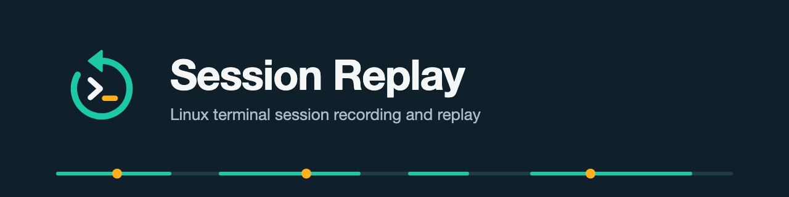
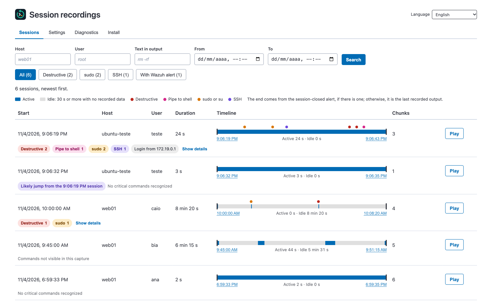
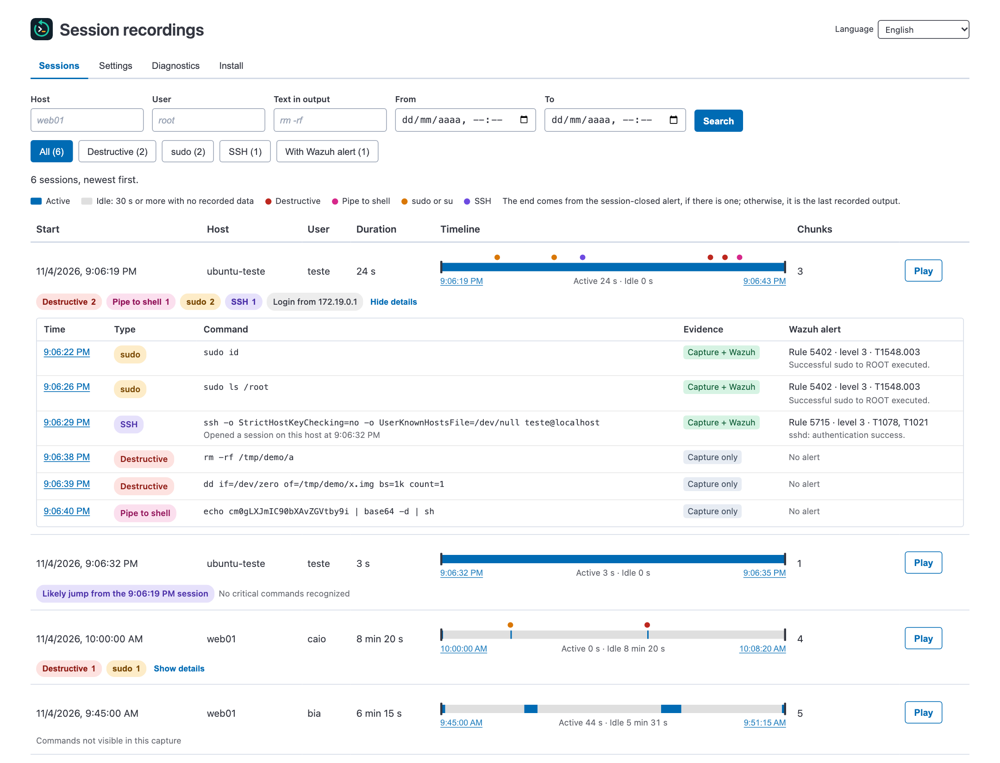
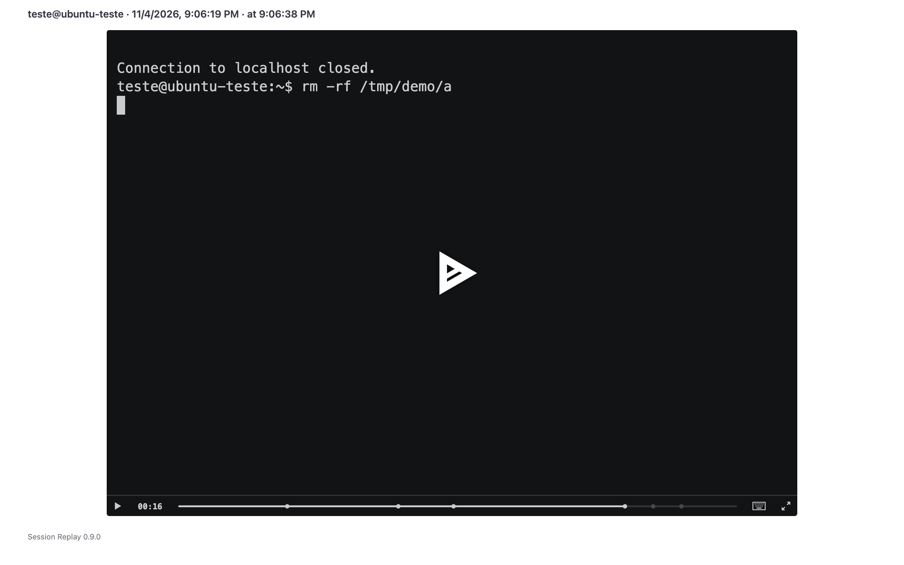
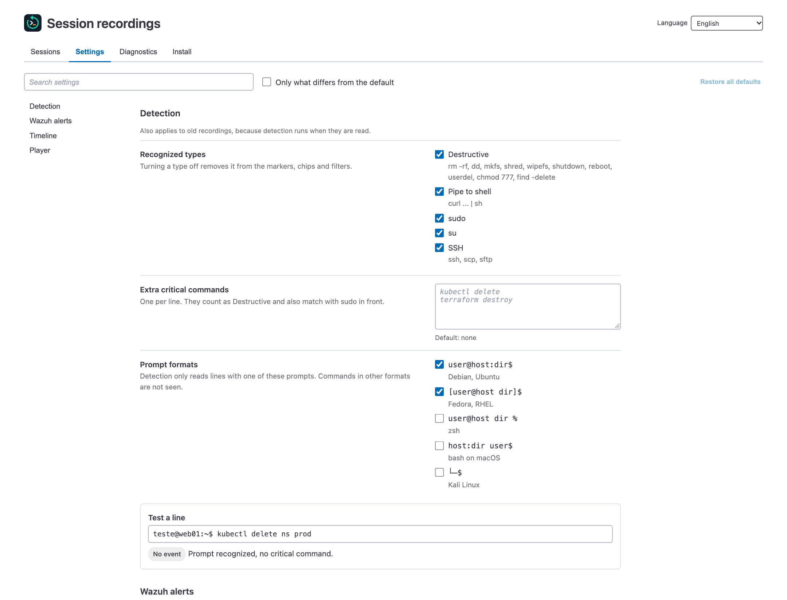
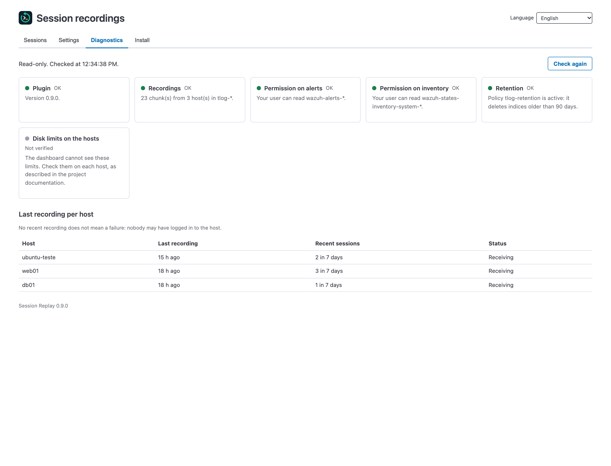
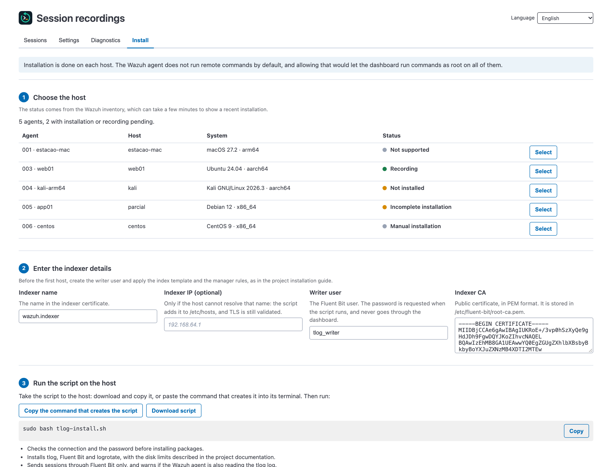
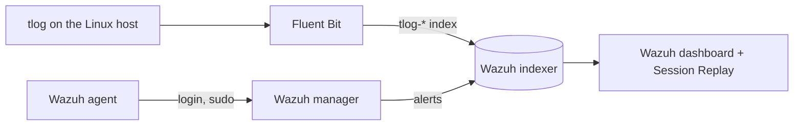

<p align="center">
  
</p>

<p align="center">
  
  
  
  
</p>

<p align="center"><strong>English</strong> · <a href="README.md">Português (Brasil)</a></p>

**Session Replay** is an open source plugin for the Wazuh dashboard. It shows what happened in each terminal session on your Linux hosts, in the same place as your alerts, and lets you watch each session like a video.

## What it is for

An alert tells you that someone logged in to a host or used `sudo`, but not what they did next. To find out, you would have to log in to the host and search its logs, if they still exist.

With Session Replay, the answer is one click away:

- **Investigate an incident:** see the commands and the responses the user saw in the terminal, in the order they happened.
- **Audit privileged access:** review what administrators and third parties did, including after `sudo` or `su`.
- **Meet audit requirements:** keep recordings for a defined period, with separate permissions for writing and reading.

## Screens



| Critical commands and alerts | Replay at the moment of a command |
|---|---|
|  |  |

| Settings | Diagnostics | Guided installation |
|---|---|---|
|  |  |  |

The images come from the project's simulated environment, with fictional data. The plugin also appears in the side menu, on the home page and on each agent's page.

## Features

- **Replay in the browser:** sessions open in a player, with nothing to install on the analyst's computer.
- **Timeline for each session:** shows the start, the end, active stretches and pauses.
- **Critical commands:** recognizes `sudo`, `su`, SSH, destructive commands and pipes to a shell. You can add your own.
- **Evidence for each command:** tells you whether it appeared in the recording, in a Wazuh alert or in both.
- **Jump to the exact moment:** each time opens the replay at that point.
- **Sessions per agent:** an agent's page shows only its sessions.
- **Logged-in user's permissions:** the plugin queries the indices with the access of whoever is using the dashboard.
- **Guided installation:** the **Install** tab generates a script for Ubuntu, Debian and Kali, with no passwords in it.
- **Recording of all users:** the optional `tlog-record-all` command includes new users and preserves emergency accounts.
- **Disk limits:** log rotation, rate limiting and retention come configured.
- **English and Portuguese:** each user picks the language in the app header. The choice is saved in that user's browser.

## How it works



The plugin only reads the indices: tlog records, and Fluent Bit sends. The details are in the [architecture](docs/en/architecture.md).

## Compatibility

| Component | Tested with |
|---|---|
| Wazuh platform | 4.14.9, single-node |
| OpenSearch Dashboards | 2.19.6 |
| tlog and Fluent Bit | tlog 14 and Fluent Bit 5.1 |
| Recorded hosts | Ubuntu 24.04 and Kali, in containers, on arm64 |

The dashboard only accepts a plugin built for its exact version, so you need to build the package for the version you use. The project is in **beta**: it has not been tested on physical or virtual machines, on amd64, or at high volume. The complete list is in the [test status](docs/en/testing.md).

## Quick start

Build the package with your dashboard version:

```bash
npm ci
```

```bash
npm run build -- --osd-version=2.19.6
```

Install the `.zip` generated in `dist/` on the dashboard server and restart the service:

```bash
sudo -u wazuh-dashboard /usr/share/wazuh-dashboard/bin/opensearch-dashboards-plugin install file:///path/to/tlogReplay-VERSION_osd-2.19.6.zip
```

```bash
sudo systemctl restart wazuh-dashboard
```

Then prepare the index and the permissions, and open **Session Replay > Install** to set up the hosts. The step-by-step instructions are in the [installation guide](docs/en/installation.md). If you prefer, an agent such as Codex or Claude Code can [do the installation](docs/en/agent-installation.md).

> [!IMPORTANT]
> Recording a terminal captures everything that appears in it, including sensitive data. Tell your users, and check the privacy rules that apply to you before you enable recording.

## Documentation

| Document | Content |
|---|---|
| [Installation](docs/en/installation.md) | Build, prepare the indexer and install the plugin |
| [Installation with an agent](docs/en/agent-installation.md) | Instructions for Codex, Claude Code and similar agents to do the installation |
| [Manual installation](docs/en/manual-installation.md) | Set up a host without the script, and the disk limits |
| [Usage guide](docs/en/usage.md) | Sessions, settings, diagnostics, language and recording all users |
| [Architecture](docs/en/architecture.md) | Data flow and code layout |
| [Troubleshooting](docs/en/troubleshooting.md) | Common symptoms and how to fix them |
| [Limitations](docs/en/limitations.md) | What the plugin does not see or guarantee |
| [Test status](docs/en/testing.md) | What was verified and what is missing |
| [Security analysis](docs/en/security-analysis.md) | Findings, fixes and remaining risks |
| [Best practices](docs/en/best-practices.md) | Comparison with Wazuh and OpenSearch guidance |
| [Visual identity](docs/en/visual-identity.md) | Logo, colors and usage rules |

## Contributing and reporting flaws

Contributions are welcome: see the [contributing guide](docs/en/contributing.md) and the [changelog](docs/en/changelog.md). **Do not open public issues for security flaws**: follow the [security policy](docs/en/security-policy.md).

## License and trademarks

Distributed under the [Apache-2.0 license](LICENSE). Third-party components are listed in the [NOTICE](NOTICE) file.

This is an independent community project, with no affiliation with, sponsorship by or endorsement from Wazuh, Inc. WAZUH is a trademark of Wazuh, Inc., and OpenSearch is a trademark of LF Projects, LLC. These names appear here only to identify the software the plugin is compatible with.
