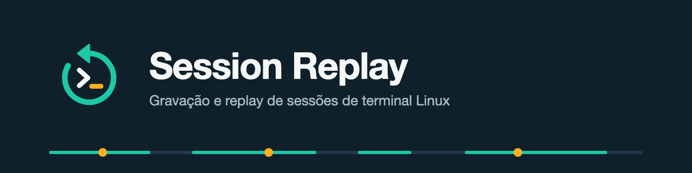
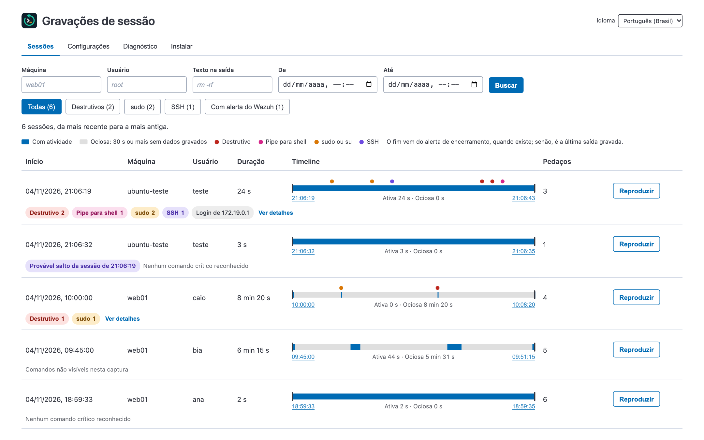
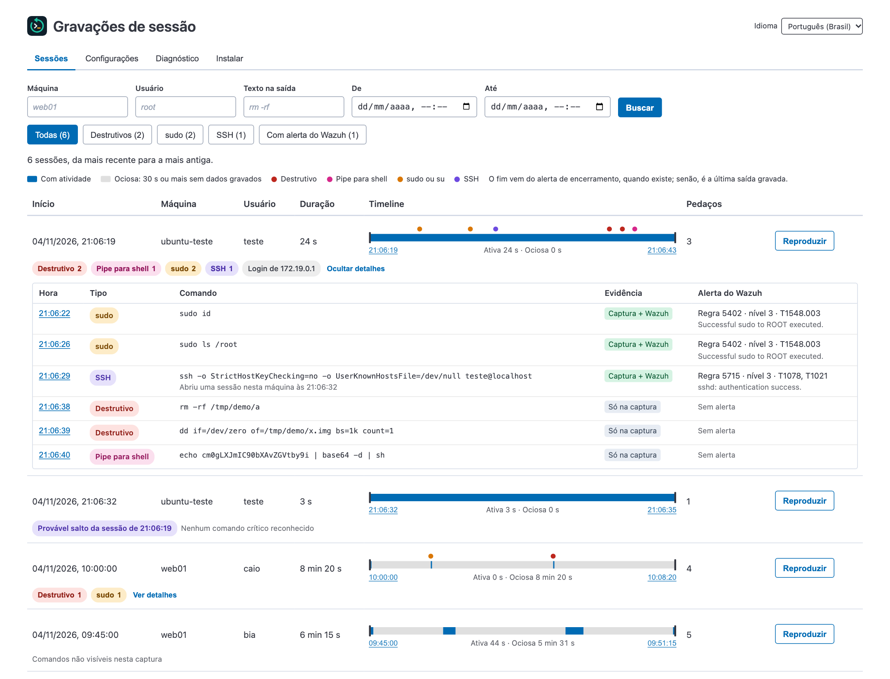
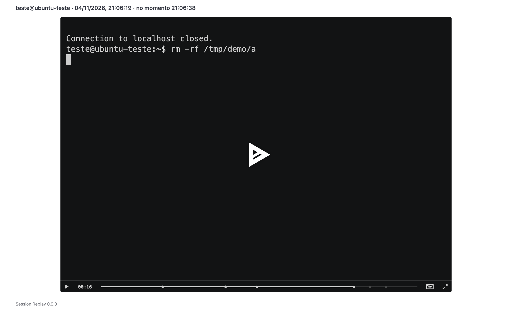
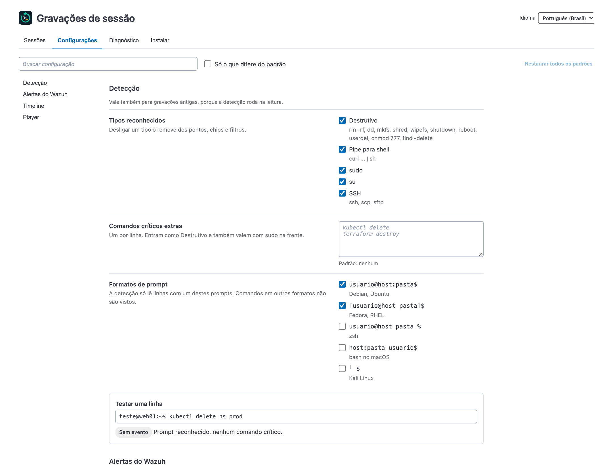
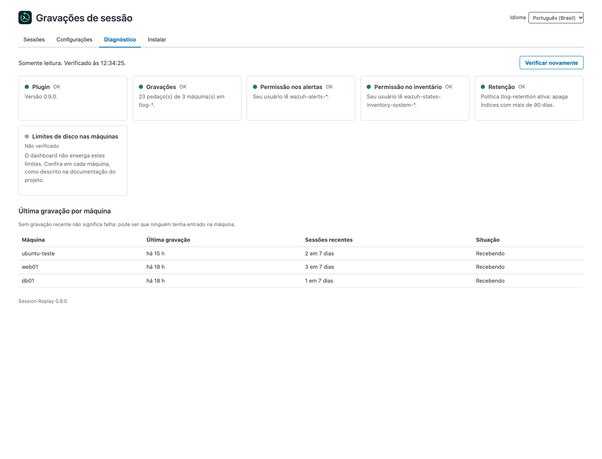
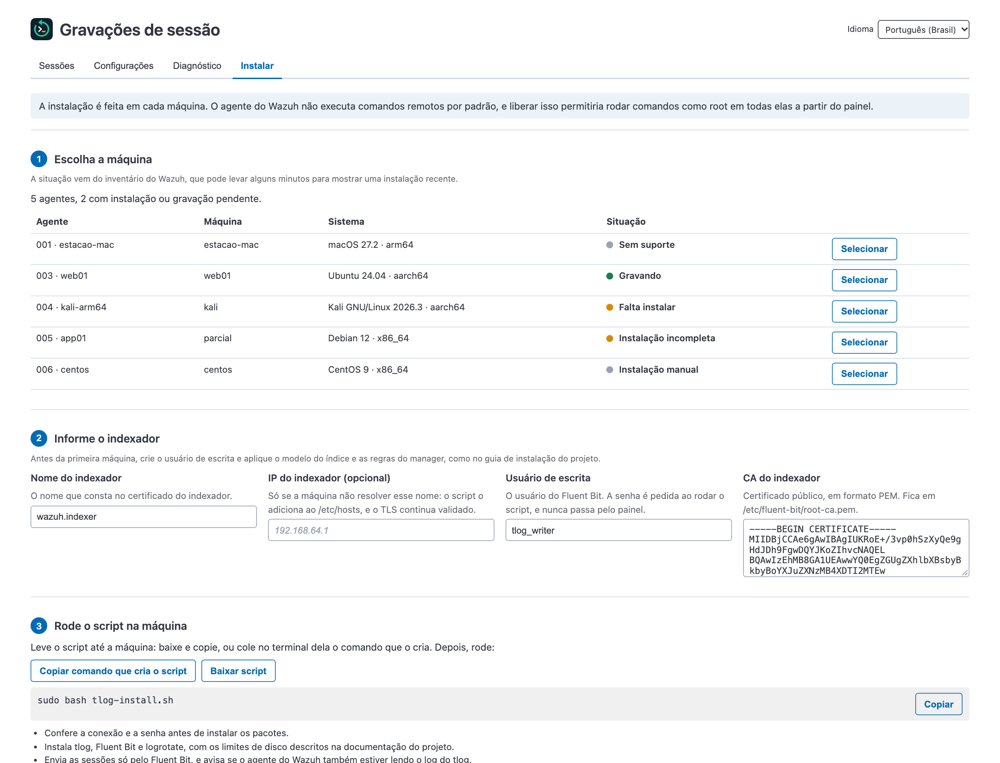
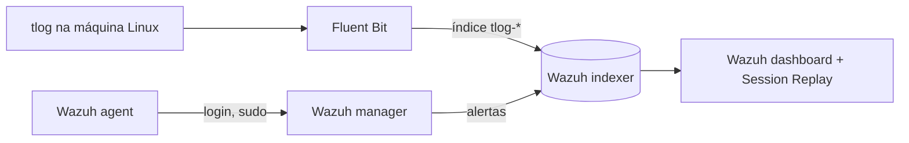

<p align="center">
  
</p>

<p align="center"><a href="README.en.md">English</a> · <strong>Português (Brasil)</strong></p>

<p align="center">
  
  
  
  
</p>

**Session Replay** é um plugin de código aberto para o Wazuh dashboard. Ele mostra, no mesmo painel dos alertas, o que aconteceu em cada sessão de terminal das suas máquinas Linux, e permite assistir a cada uma como um vídeo.

> **English:** the plugin interface is available in English and Portuguese, and the full documentation is in [README.en.md](README.en.md).

## Para que serve

Um alerta informa que alguém entrou em uma máquina ou usou `sudo`, mas não mostra o que foi feito depois. Para responder a isso, você precisaria entrar na máquina e procurar nos logs, se eles ainda existirem.

Com o Session Replay, a resposta fica a um clique:

- **Investigar um incidente:** veja os comandos e as respostas que o usuário viu no terminal, na ordem em que aconteceram.
- **Auditar acessos privilegiados:** revise o que administradores e terceiros fizeram, inclusive depois de um `sudo` ou `su`.
- **Atender a exigências de auditoria:** guarde as gravações por um prazo definido, com permissões separadas para quem escreve e para quem lê.

## Telas



| Comandos críticos e alertas | Replay no momento do comando |
|---|---|
|  |  |

| Configurações | Diagnóstico | Instalação guiada |
|---|---|---|
|  |  |  |

As imagens vêm do ambiente simulado do projeto, com dados fictícios. O plugin também aparece no menu lateral, na home e na tela de cada agente.

## Recursos

- **Replay no navegador:** as sessões abrem em um player, sem instalar nada na máquina do analista.
- **Timeline de cada sessão:** mostra início, fim, trechos com atividade e pausas.
- **Comandos críticos:** reconhece `sudo`, `su`, SSH, comandos destrutivos e pipe para shell. Você pode acrescentar os seus.
- **Evidência de cada comando:** informa se ele apareceu na gravação, em um alerta Wazuh ou nos dois.
- **Salto para o momento exato:** cada horário abre o replay naquele ponto.
- **Sessões por agente:** a tela de um agente mostra só as sessões dele.
- **Permissões do usuário logado:** o plugin consulta os índices com o acesso de quem está usando o painel.
- **Instalação guiada:** a aba **Instalar** gera um script para Ubuntu, Debian e Kali, sem senhas no conteúdo.
- **Gravação de todos os usuários:** o comando `tlog-record-all` opcional inclui os usuários novos e preserva contas de emergência.
- **Limites de disco:** a rotação do log, o limite de taxa e a retenção já vêm configurados.
- **Inglês e português:** cada usuário escolhe o idioma no cabeçalho do app, e a escolha fica salva no navegador dele.

## Como funciona



O plugin só lê os índices: quem grava é o tlog, e quem envia é o Fluent Bit. Os detalhes estão na [arquitetura](docs/arquitetura.md).

## Compatibilidade

| Componente | Testado com |
|---|---|
| Plataforma Wazuh | 4.14.9, single-node |
| OpenSearch Dashboards | 2.19.6 |
| tlog e Fluent Bit | tlog 14 e Fluent Bit 5.1 |
| Máquinas gravadas | Ubuntu 24.04 e Kali, em contêiner, em arm64 |

O dashboard só aceita um plugin compilado para a mesma versão dele, então é preciso gerar o pacote para a versão que você usa. O projeto está em **beta**: ainda não foi testado em máquinas físicas ou virtuais, em amd64, nem com volume alto. A lista completa está na [situação dos testes](docs/testes.md).

## Início rápido

Compile o pacote com a versão do seu dashboard:

```bash
npm ci
```

```bash
npm run build -- --osd-version=2.19.6
```

Instale o `.zip` gerado em `dist/` no servidor do dashboard e reinicie o serviço:

```bash
sudo -u wazuh-dashboard /usr/share/wazuh-dashboard/bin/opensearch-dashboards-plugin install file:///caminho/tlogReplay-VERSAO_osd-2.19.6.zip
```

```bash
sudo systemctl restart wazuh-dashboard
```

Depois, prepare o índice e as permissões e abra **Session Replay > Instalar** para configurar as máquinas. O passo a passo está no [guia de instalação](docs/instalacao.md).

> [!IMPORTANT]
> Gravar um terminal captura tudo o que aparece nele, inclusive dados sensíveis. Avise os usuários e confira as regras de privacidade que se aplicam a você antes de ativar a gravação.

## Documentação

| Documento | Conteúdo |
|---|---|
| [Instalação](docs/instalacao.md) | Compilar, preparar o indexador e instalar o plugin |
| [Instalação manual](docs/instalacao-manual.md) | Configurar uma máquina sem o script, e os limites de disco |
| [Guia de uso](docs/uso.md) | Sessões, configurações, diagnóstico, idioma e gravação de todos os usuários |
| [Arquitetura](docs/arquitetura.md) | Fluxo dos dados e organização do código |
| [Solução de problemas](docs/solucao-de-problemas.md) | Sintomas comuns e como resolver |
| [Limitações](docs/limitacoes.md) | O que o plugin não vê ou não garante |
| [Situação dos testes](docs/testes.md) | O que foi verificado e o que falta |
| [Análise de segurança](docs/analise-de-seguranca.md) | Achados, correções e riscos que continuam |
| [Boas práticas](docs/boas-praticas.md) | Comparação com as orientações da Wazuh e do OpenSearch |
| [Identidade visual](docs/identidade-visual.md) | Logo, cores e regras de uso |

## Contribuir e relatar falhas

Contribuições são bem-vindas: veja o [guia de contribuição](CONTRIBUTING.md) e o [histórico de mudanças](CHANGELOG.md). **Não abra issues públicas para falhas de segurança**: siga a [política de segurança](SECURITY.md).

## Licença e marcas

Distribuído sob a [licença Apache-2.0](LICENSE). Os componentes de terceiros estão no arquivo [NOTICE](NOTICE).

Este é um projeto independente da comunidade, sem afiliação, patrocínio ou endosso da Wazuh, Inc. WAZUH é uma marca da Wazuh, Inc., e OpenSearch é uma marca da LF Projects, LLC. Esses nomes aparecem aqui só para identificar o software com o qual o plugin é compatível.
