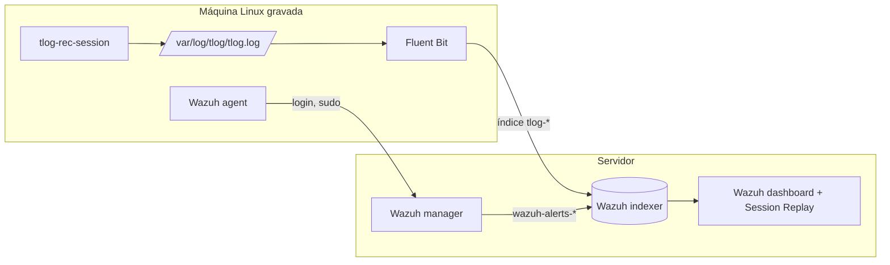

# Arquitetura

## Fluxo dos dados

1. O `tlog-rec-session` é o shell de login do usuário gravado. Ele grava a saída do terminal em `/var/log/tlog/tlog.log`.
2. O Fluent Bit lê esse log e envia os pedaços ao índice diário `tlog-*`, com um usuário que só pode escrever.
3. O Wazuh agent continua enviando os eventos de login e sudo, que viram alertas. Ele não lê o log do tlog.
4. O plugin consulta os índices com as permissões do usuário logado, monta a timeline e liga os comandos aos alertas na leitura. Por isso, mudar uma configuração também vale para gravações antigas.
5. O navegador recebe a gravação convertida para asciicast e a reproduz com o asciinema-player. A entrada do usuário (`in_txt`) nunca sai pela API.

## Carregador e atualização sem limpar o cache

O dashboard manda o navegador guardar o bundle do plugin por um ano, em um endereço que só muda com a versão do dashboard. Por isso, esse arquivo é só um carregador fixo ([src/public/index.js](../src/public/index.js)), que lê um manifesto sempre atualizado e carrega os scripts pela rota `/api/tlog_replay/assets/`, com o hash do conteúdo no nome. Evite alterar o carregador, o formato do manifesto e os nomes globais: navegadores continuam usando a cópia antiga do carregador.

## Instalação remota

**A instalação não é remota.** O Wazuh agent vem com a execução de comandos remotos desligada (`logcollector.remote_commands=0` e `wazuh_command.remote_commands=0`), e o active response só roda scripts que já estão na máquina. Ligar essas opções daria ao painel o poder de rodar comandos como root em todos os agentes, então o plugin não usa esse caminho.

## Código

| Caminho | Conteúdo |
|---|---|
| `src/server/` | Rotas da API e saved object das configurações |
| `src/lib/` | Conversão, consultas, detecção de comandos, timeline e script de instalação |
| `src/public/` | Carregador fixo, app, painéis e itens de menu |
| `collector/` | Arquivos de configuração das máquinas e do servidor |
| `scripts/` | Build, ambiente simulado e geração das imagens |
| `samples/` | Gravações e alertas do laboratório, sem dados reais |
| `test/` | Testes automatizados |
| `test-env/` | Máquina Ubuntu de teste. Roda com `--privileged`, então é só para testes locais |
