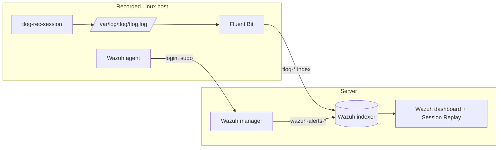

# Architecture

[Português](../arquitetura.md)

## Data flow

1. `tlog-rec-session` is the login shell of the recorded user. It writes the terminal output to `/var/log/tlog/tlog.log`.
2. Fluent Bit reads that log and sends the chunks to the daily `tlog-*` index, with a user that can only write.
3. The Wazuh agent keeps sending login and sudo events, which become alerts. It does not read the tlog log.
4. The plugin queries the indices with the permissions of the logged-in user, builds the timeline and links commands to alerts when reading. That is why changing a setting also applies to old recordings.
5. The browser receives the recording converted to asciicast and plays it with asciinema-player. User input (`in_txt`) never leaves through the API.

## Loader and updates without clearing the cache

The dashboard tells the browser to keep the plugin bundle for a year, at an address that only changes with the dashboard version. That is why this file is only a fixed loader ([src/public/index.js](../../src/public/index.js)), which reads an always up-to-date manifest and loads the scripts through the `/api/tlog_replay/assets/` route, with the content hash in the name. Avoid changing the loader, the manifest format and the global names: browsers keep using the old copy of the loader.

## Language

OpenSearch Dashboards has one language per server (`i18n.locale`), with no switch per user, and its list of translations has no Brazilian Portuguese. So the plugin has its own catalog, in [src/lib/messages/](../../src/lib/messages/), with stable namespaced IDs, like those of `i18n.translate`. To add a language, create a catalog file and register it in [src/lib/i18n.js](../../src/lib/i18n.js).

- **Browser:** the choice is saved in `localStorage`, under `tlogReplay.locale`. Changing it rebuilds the screen in the new language.
- **Server:** the browser sends the language in the `x-tlog-replay-locale` header, and each request keeps its own language in an `AsyncLocalStorage`. Without a valid header, the answer is in English. Validators run before the handler, so their messages are in English. The screen does not trigger them.
- **Dashboard log:** messages stay in Portuguese, as in `Replay aberto`, so that anything searching the log keeps working.

## Remote installation

**Installation is not remote.** The Wazuh agent comes with remote command execution turned off (`logcollector.remote_commands=0` and `wazuh_command.remote_commands=0`), and active response only runs scripts that are already on the host. Turning those options on would give the dashboard the power to run commands as root on all agents, so the plugin does not use that path.

## Code

| Path | Content |
|---|---|
| `src/server/` | API routes and the settings saved object |
| `src/lib/` | Conversion, queries, command detection, timeline, install script and message catalogs |
| `src/public/` | Fixed loader, app, panels and menu items |
| `collector/` | Configuration files for the hosts and the server |
| `scripts/` | Build, simulated environment and image generation |
| `samples/` | Recordings and alerts from the lab, with no real data |
| `test/` | Automated tests |
| `test-env/` | Ubuntu test machine. It runs with `--privileged`, so it is for local tests only |
