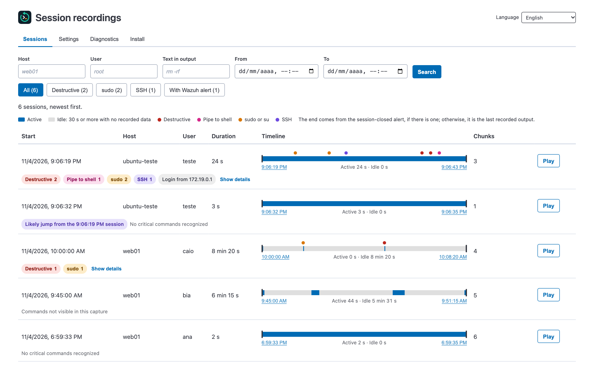
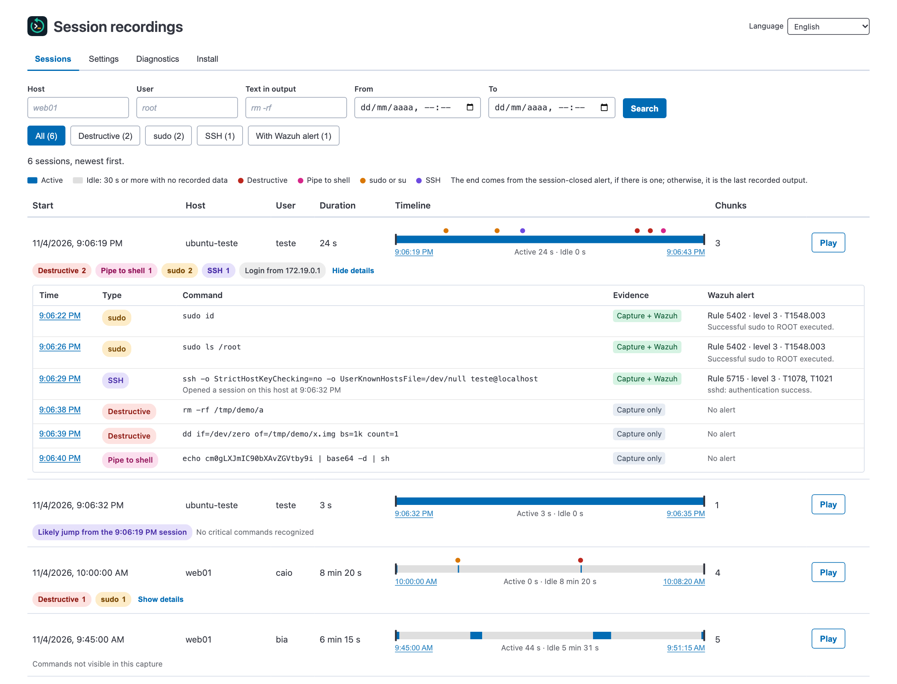
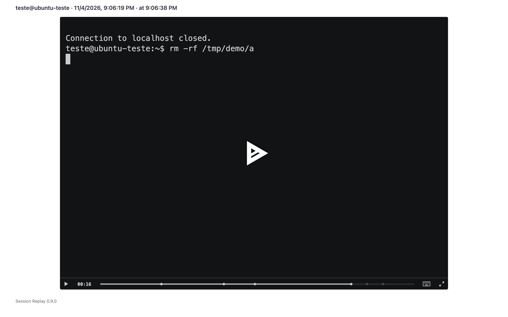
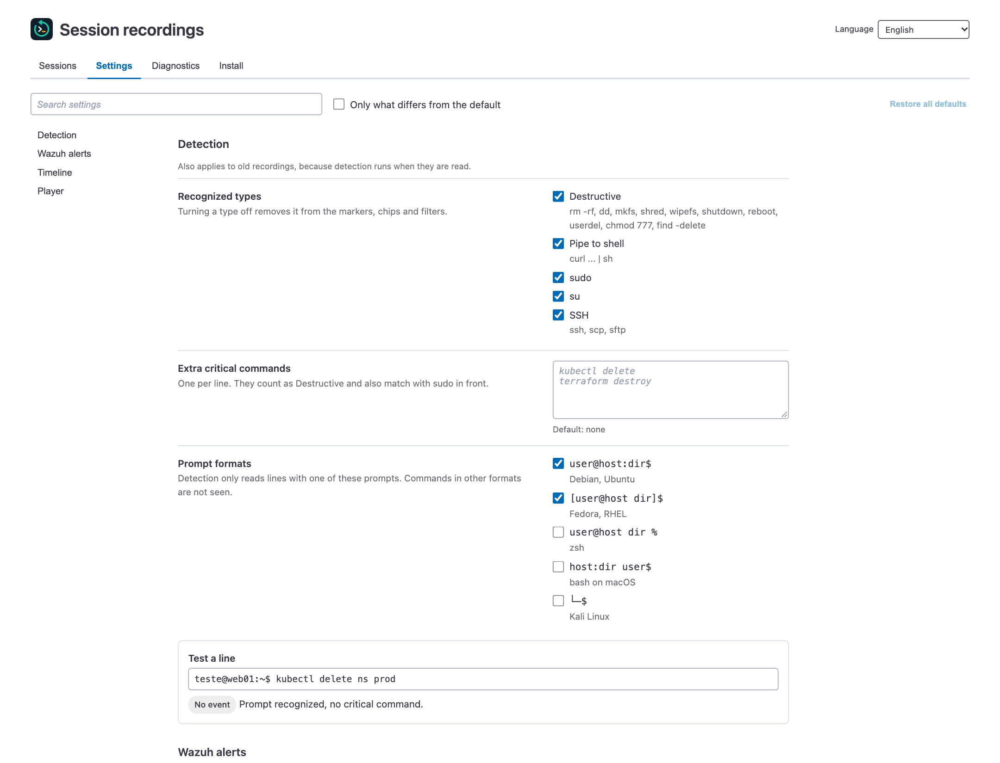
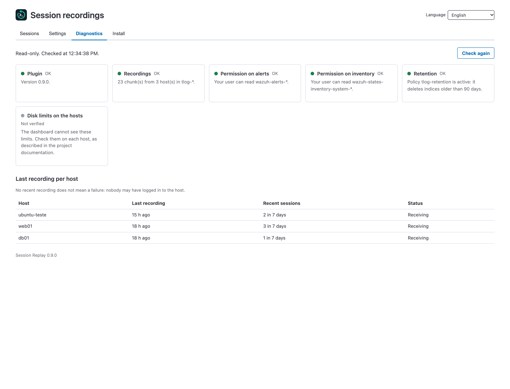
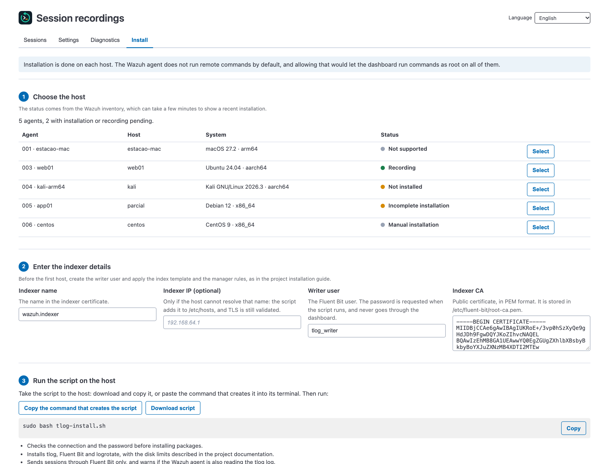

# Usage guide

[Português](../uso.md)

The app is at `/app/tlogReplay`, named **Session Replay**, in the **Session recording** group of the sidebar, and has a card under **Security operations** on the home page. It also appears on each agent's page, as a tab and inside the **More...** menu, and in that case shows only the sessions of that agent.

## Language

The **Language** selector in the app header switches between English and Portuguese (Brazil). The choice applies only to you, because it is saved in your browser, and the screen stays on the same tab. Unsaved changes on the **Settings** tab are lost when you switch.

On first use, the app follows the browser language: Portuguese if it is Portuguese, and English otherwise. Dates and times follow the selected language.

## Sessions



Each session shows the critical commands recognized: dots on the timeline, with a balloon on hover, chips below the row and a table under **Show details**. Each item reports its evidence:

| Evidence | Meaning |
|---|---|
| **Capture + Wazuh** | The command appears in the recording, and a Wazuh alert was linked to it |
| **Capture only** | The command appears in the recording, but no alert was linked to it. The default Wazuh rules do not alert on `rm` or `dd` |
| **Wazuh only** | There is a `sudo` alert for the user in the period, with no command recognized in the recording and no other open session for that user |

The recognized types are `sudo`, `su`, SSH (`ssh`, `scp`, `sftp`), destructive commands (such as `rm -rf`, `dd of=`, `mkfs`, `shred`, `wipefs`, `shutdown`, `reboot`, `userdel` and `chmod 777`) and pipes to a shell. The list is in [src/lib/session_events.js](../../src/lib/session_events.js).



The times on the timeline and in the **Time** column are links that open the replay at that moment, with the player paused. For a command, the moment is when Enter was pressed, and the screen already shows the typed command. Events also appear as markers on the player bar.

The app is at most 1400 px wide and the player 1100 px. In smaller spaces, sessions and details become blocks, with no horizontal scrolling.



## Settings



The **Settings** tab applies to all users and does not require a restart:

| Setting | Default |
|---|---|
| Recognized types | All on |
| Extra critical commands (one per line, no regular expressions) | None |
| Prompt formats | Debian/Ubuntu and Fedora/RHEL; zsh, macOS and Kali are optional |
| Link commands to alerts | On |
| Time before a session counts as idle | 30 s |
| Maximum pause in the replay | 2 s |

The detection, alert and timeline settings also apply to old recordings, because the analysis runs when they are read. **Test a line** shows how a line would be classified before you save.

**Who can change them:** users with the `all_access` role or with an indexer role named `tlog_replay_admin`. That role needs no permissions: it only has to exist and be mapped to the user. Users who can read `tlog-*` see the values but cannot change them. Users who cannot read it see nothing. Who made each change appears in **Recent changes**, visible only to those who can change settings, and in the dashboard log.

**Where they are stored:** in a hidden saved object of type `tlog-replay-settings`, in the `.kibana` index, out of the saved objects screen and API. If reading fails, the analysis uses the default values and logs the error.

**When you first install this version:** the new type makes the dashboard migrate `.kibana` to a new index at startup. Removing the plugin does not delete the object: it stays there with no effect and applies again if you reinstall.

## Diagnostics



The **Diagnostics** tab is read-only and uses the permissions of the logged-in user. It shows the plugin version, the recordings received, the permissions on alerts and inventory, the retention policy and the last recording per host. It cannot see the disk limits on the recorded hosts, and a host with no recent recording may simply have had no logins.

## Install



The **Install** tab shows the status of each agent and generates a script for Ubuntu 22.04 and 24.04, Debian 12 and 13, and Kali. The script contains no passwords: it asks for the writer user password when it runs and checks the connection before installing packages. It also does not enable recording for any user, which is a separate step on the same tab.

The script and the commands it installs use the language selected when the script was generated.

**Installation is not remote.** The Wazuh agent comes with remote command execution turned off (`logcollector.remote_commands=0` and `wazuh_command.remote_commands=0`), and active response only runs scripts that are already on the host. Turning those options on would give the dashboard the power to run commands as root on all agents, so the plugin does not use that path.

The status comes from the `wazuh-states-inventory-system-*` and `wazuh-states-inventory-packages-*` indices, with the permissions of the logged-in user. Without access to the packages, it appears as "Not verified". The inventory is updated periodically and can take a while to show a recent installation. The form is filled with the indexer name and CA when the dashboard has them as text; otherwise, paste the CA.

### Record all users

The script installs the `tlog-record-all` command, turned off, and step 4 of the tab has the commands:

```bash
sudo tlog-record-all enable EMERGENCY_USER
sudo tlog-record-all status
sudo tlog-record-all disable
```

A `systemd` unit watches `/etc/passwd` and enables recording for every user with a regular UID and a login shell, including users created later and users who change their shell. The command refuses to run without at least one emergency user with a password and sudo because, if tlog fails, no recorded user can log in. Sessions of emergency users are not recorded. `disable` restores each user's original shell. To change the exceptions, run `disable` and `enable` again. root does not change; what it does after `sudo` or `su` in a recorded session appears in the recording.

Limits of this option:

- **LDAP and AD:** these users are not in `/etc/passwd` and need recording through SSSD.
- **Commands without a terminal:** `ssh host command` is also recorded, and automation accounts with a real shell fall under the rule. Add them to the exceptions.
- **Downloads:** the output of a recorded user goes through the 16 KiB/s limit. Downloading 2 MB with `rsync` or `scp -O` takes about 2 minutes and generates about 4 MB of log. With `Subsystem sftp internal-sftp` in `sshd`, `sftp` and regular `scp` do not go through the shell: they are fast, but those transfers are no longer recorded. Uploading files to the host is not affected.

On Kali, turn on the `└─$` prompt format in **Settings**, or critical commands will not be detected. Kali follows Debian testing, and the script uses the Fluent Bit package for Debian 13.

The images on this page come from the project's simulated environment, with fictional data.
