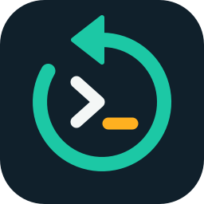

# Visual identity

[Português](../identidade-visual.md)



The logo brings together three ideas: the **circular arrow** of replay, the terminal **prompt** and the **amber cursor**, which recalls the critical points marked on the timeline.

## Files

| File | Use |
|---|---|
| [`logo.svg`](../../assets/brand/logo.svg) | Main logo, with a dark background. It also appears in the plugin header |
| [`logo-transparent.svg`](../../assets/brand/logo-transparent.svg) | No background, for light surfaces |
| [`logo-512.png`](../../assets/brand/logo-512.png) and [`logo-128.png`](../../assets/brand/logo-128.png) | Where SVG is not accepted |
| [`banner-en.png`](../../assets/brand/banner-en.png) and [`banner.png`](../../assets/brand/banner.png) | Top of the English and Portuguese READMEs |
| [`social-preview.png`](../../assets/brand/social-preview.png) | Repository sharing image, at 1280 × 640 |

## Colors

| Name | Hexadecimal | Use |
|---|---|---|
| Ink | `#10202B` | Background, and text on light surfaces |
| Replay | `#1CC8A5` | Arrow and active stretches. On a light background, `#12A488` |
| Event | `#FFB020` | Cursor and critical points. On a light background, `#E08E00` |
| Paper | `#F4F7F6` | Prompt and text on a dark background |
| Mist | `#A9BDC4` | Secondary text on a dark background |

## Rules

- Keep a clear margin of at least 1/8 of the width around the logo.
- Do not use the logo below 16 px.
- Do not change the colors, distort it or add effects.
- Do not combine it with the Wazuh logo: the [trademark policy](https://wazuh.com/docs/legal-resources/Trademark_and_Brand_Policy_May_2024.pdf) requires a written license for that.
- The sidebar, home and agent menu icons keep OUI's `videoPlayer`, to match the other icons in the dashboard. The loader, which defines the sidebar icon, is also kept in the browser for up to a year.

## Screen images

The images in `docs/images` are generated by the simulated environment, with fictional data. The English ones are in `docs/images/en`:

```bash
npm run build -- --osd-version=2.19.6
```

```bash
npm run screenshots
```
