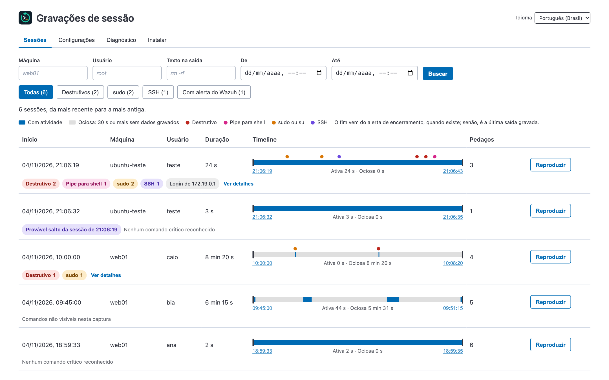
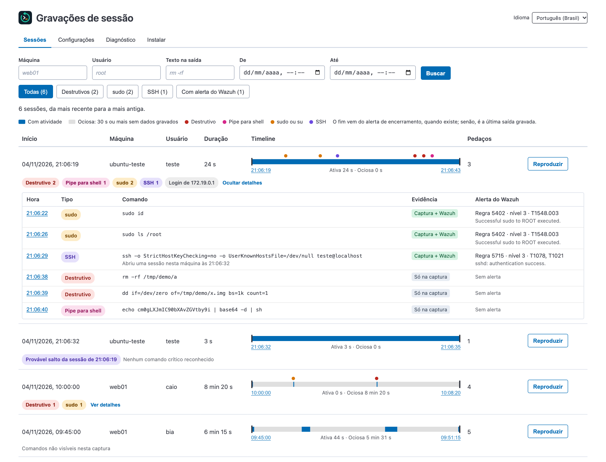
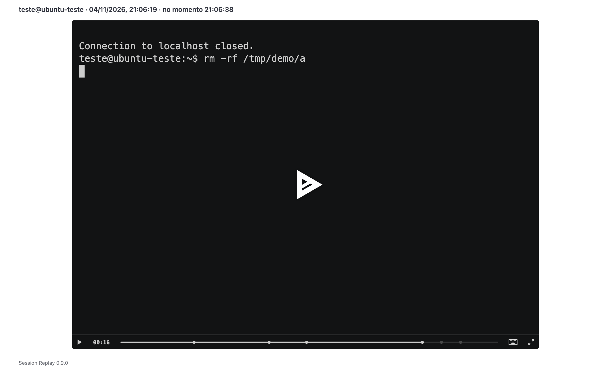
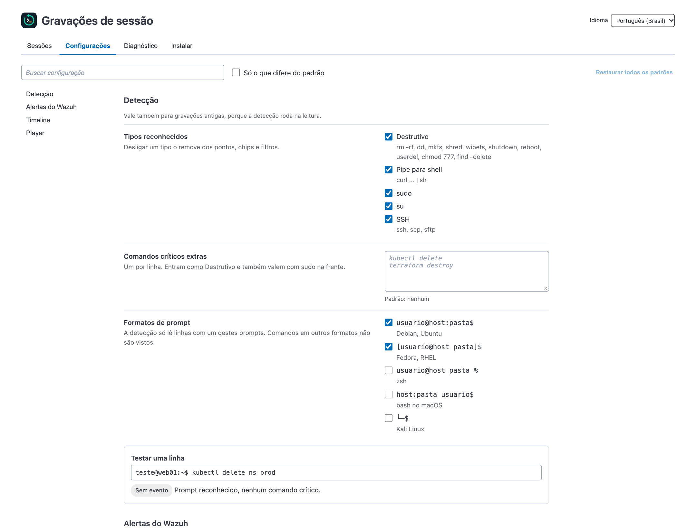
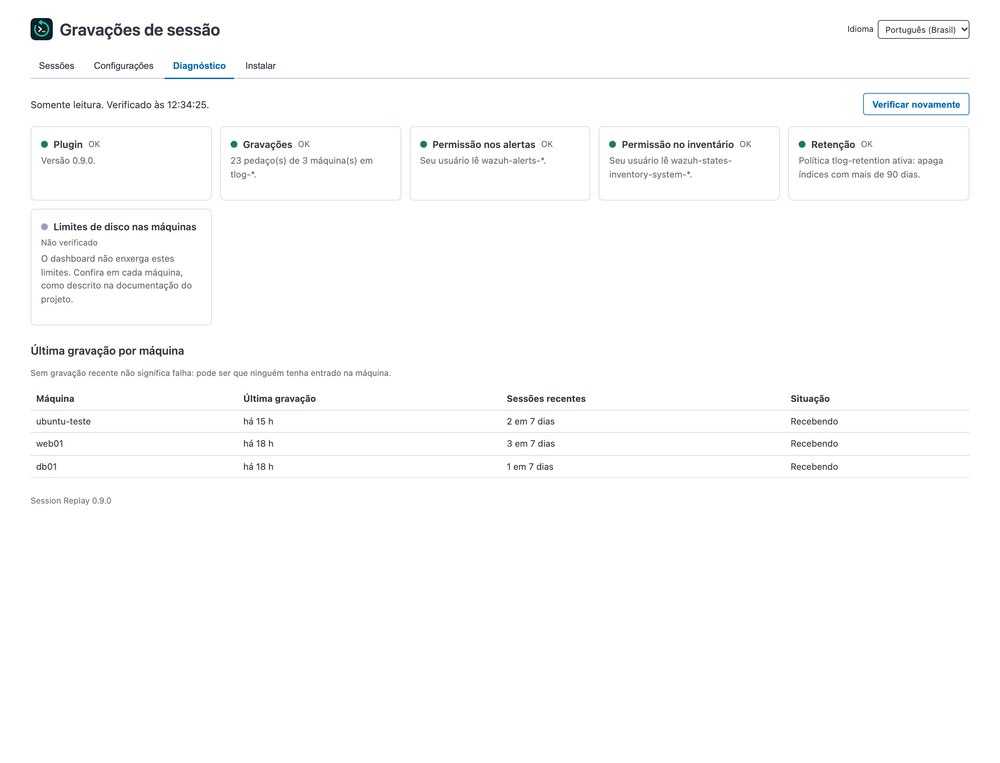
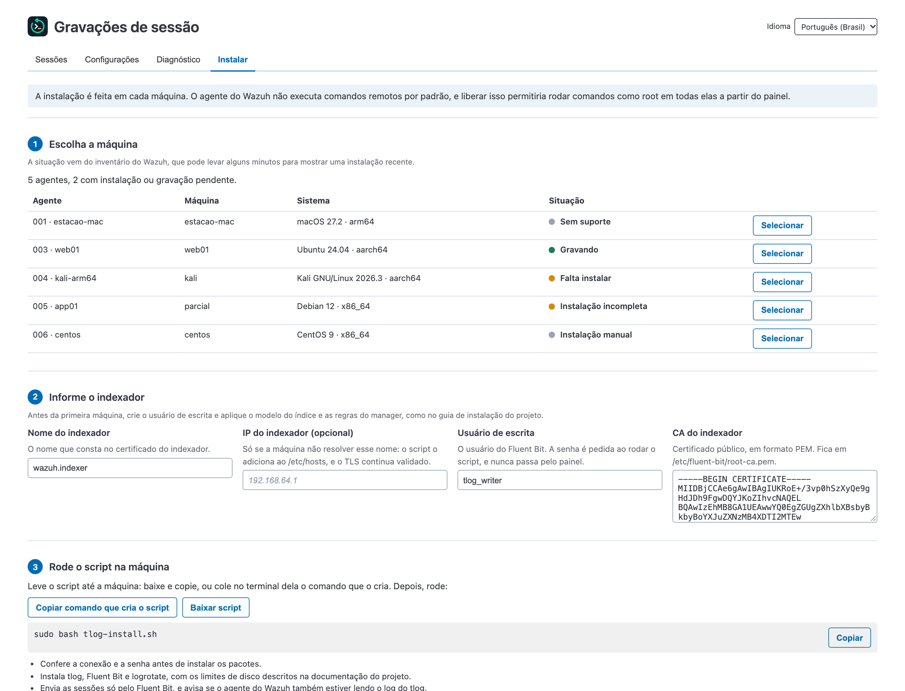

# Guia de uso

[English](en/usage.md)

O app fica em `/app/tlogReplay`, com o nome **Session Replay**, no grupo **Session recording** da sidebar, e tem um card em **Security operations**, na home. Ele também aparece na tela de cada agente, como aba e dentro do menu **More...**, e nesse caso mostra só as sessões daquele agente.

## Idioma

O seletor **Idioma**, no cabeçalho do app, troca entre inglês e português do Brasil. A escolha vale só para você, porque fica salva no seu navegador, e a tela continua na mesma aba. Alterações não salvas na aba **Configurações** se perdem na troca.

No primeiro uso, o app segue o idioma do navegador: português se ele estiver em português, e inglês nos demais casos. Datas e horários acompanham o idioma escolhido.

## Sessões



Cada sessão mostra os comandos críticos reconhecidos: pontos na timeline, com balão ao passar o mouse, chips abaixo da linha e uma tabela em **Ver detalhes**. Cada item informa a evidência:

| Evidência | Significado |
|---|---|
| **Captura + Wazuh** | O comando aparece na gravação e um alerta Wazuh foi ligado a ele |
| **Só na captura** | O comando aparece na gravação, mas nenhum alerta foi ligado a ele. As regras Wazuh padrão não alertam `rm` ou `dd` |
| **Só no Wazuh** | Há um alerta de `sudo` do usuário no período, sem comando reconhecido na gravação e sem outra sessão dele aberta |

Os tipos reconhecidos são `sudo`, `su`, SSH (`ssh`, `scp`, `sftp`), comandos destrutivos (como `rm -rf`, `dd of=`, `mkfs`, `shred`, `wipefs`, `shutdown`, `reboot`, `userdel` e `chmod 777`) e pipe para shell. A lista fica em [src/lib/session_events.js](../src/lib/session_events.js).



Os horários da timeline e da coluna **Hora** são links que abrem o replay naquele momento, com o player pausado. Em um comando, o momento é o do Enter, e a tela já mostra o comando digitado. Os eventos também aparecem como marcadores na barra do player.

O app tem no máximo 1400 px de largura e o player, 1100 px. Em espaços menores, as sessões e os detalhes viram blocos, sem rolagem lateral.



## Configurações



A aba **Configurações** vale para todos os usuários e não exige reiniciar:

| Ajuste | Padrão |
|---|---|
| Tipos reconhecidos | Todos ligados |
| Comandos críticos extras (um por linha, sem expressão regular) | Nenhum |
| Formatos de prompt | Debian/Ubuntu e Fedora/RHEL; zsh, macOS e Kali são opcionais |
| Ligar comandos aos alertas | Ligado |
| Tempo para considerar ociosa | 30 s |
| Pausa máxima no replay | 2 s |

Os ajustes de detecção, alertas e timeline também valem para gravações antigas, porque a análise roda na leitura. **Testar uma linha** mostra como uma linha seria classificada antes de salvar.

**Quem pode alterar:** usuários com o papel `all_access` ou com um papel do indexador chamado `tlog_replay_admin`. Esse papel não precisa de nenhuma permissão: basta existir e estar mapeado ao usuário. Quem lê `tlog-*` vê os valores, sem poder alterá-los. Quem não lê não vê nada. Quem alterou fica em **Últimas alterações**, visível só para quem pode alterar, e no log do dashboard.

**Onde fica:** em um saved object oculto do tipo `tlog-replay-settings`, no índice `.kibana`, fora da tela e da API de saved objects. Se a leitura falhar, a análise usa os valores padrão e registra o erro no log.

**Ao instalar esta versão pela primeira vez:** o tipo novo faz o dashboard migrar o `.kibana` para um novo índice na inicialização. Remover o plugin não apaga o objeto: ele continua lá sem efeito e volta a valer ao reinstalar.

## Diagnóstico



A aba **Diagnóstico** é somente leitura e usa as permissões do usuário logado. Ela mostra a versão do plugin, as gravações recebidas, as permissões em alertas e inventário, a política de retenção e a última gravação por máquina. Ela não enxerga os limites de disco das máquinas gravadas, e uma máquina sem gravação recente pode apenas não ter recebido acessos.

## Instalar



A aba **Instalar** mostra a situação de cada agente e gera um script para Ubuntu 22.04 e 24.04, Debian 12 e 13 e Kali. O script não contém senhas: ele pede a senha do usuário de escrita ao rodar e confere a conexão antes de instalar os pacotes. Ele também não ativa a gravação de nenhum usuário, o que é um passo separado na mesma aba.

O script e os comandos que ele instala usam o idioma escolhido quando o script foi gerado.

**A instalação não é remota.** O Wazuh agent vem com a execução de comandos remotos desligada (`logcollector.remote_commands=0` e `wazuh_command.remote_commands=0`), e o active response só roda scripts que já estão na máquina. Ligar essas opções daria ao painel o poder de rodar comandos como root em todos os agentes, então o plugin não usa esse caminho.

A situação vem dos índices `wazuh-states-inventory-system-*` e `wazuh-states-inventory-packages-*`, com as permissões do usuário logado. Sem acesso aos pacotes, ela aparece como "Não verificado". O inventário é atualizado de tempos em tempos e pode demorar a mostrar uma instalação recente. O formulário é preenchido com o nome e a CA do indexador quando o dashboard os tem como texto; caso contrário, cole a CA.

### Gravar todos os usuários

O script instala, desligado, o comando `tlog-record-all`, e o passo 4 da aba traz os comandos:

```bash
sudo tlog-record-all enable USUARIO_DE_EMERGENCIA
sudo tlog-record-all status
sudo tlog-record-all disable
```

Uma unidade `systemd` observa o `/etc/passwd` e ativa a gravação em todo usuário com UID comum e shell de login, inclusive os criados depois e os que trocarem de shell. O comando se recusa a rodar sem ao menos um usuário de emergência com senha e sudo, porque, se o tlog falhar, nenhum usuário gravado consegue entrar. As sessões dos usuários de emergência não são gravadas. O `disable` restaura o shell original de cada um. Para mudar as exceções, rode `disable` e `enable` de novo. O root não muda; o que ele faz depois de um `sudo` ou `su` em uma sessão gravada aparece na gravação.

Limites dessa opção:

- **LDAP e AD:** esses usuários não estão no `/etc/passwd` e precisam da gravação pelo SSSD.
- **Comandos sem terminal:** `ssh host comando` também é gravado, e contas de automação com shell real entram na regra. Coloque-as entre as exceções.
- **Downloads:** a saída de um usuário gravado passa pelo limite de 16 KiB/s. Baixar 2 MB por `rsync` ou `scp -O` leva cerca de 2 minutos e gera cerca de 4 MB de log. Com `Subsystem sftp internal-sftp` no `sshd`, `sftp` e `scp` comum não passam pelo shell: ficam rápidos, mas essas transferências deixam de ser gravadas. Enviar arquivos para a máquina não é afetado.

No Kali, ligue o formato de prompt `└─$` em **Configurações**, ou os comandos críticos não serão detectados. O Kali segue o Debian testing, e o script usa o pacote do Fluent Bit do Debian 13.

As imagens desta página vêm do ambiente simulado do projeto, com dados fictícios.
